<!-- ══════════════════════ 1. CINEMATIC HERO ══════════════════════ -->

  Hi, I'm <b>Prince</b>, an aspiring software engineer building full-stack web apps, 
  sharpening my problem-solving, and exploring how AI fits into software.

  
  
  

<!-- ══════════════════════ 2. ABOUT ME ══════════════════════ -->
<h2 align="center">About Me</h2>

  I'm early in my software engineering journey, and I'm learning by building. 
  I care about clean interfaces, code other people can read, and steady improvement over quick wins.

<table>
  <tr>
    <td align="center" width="50%">🌱 <b>Learning</b> Full-stack development with the MERN stack</td>
    <td align="center" width="50%">🧩 <b>Practicing</b> Data Structures and Algorithms</td>
  </tr>
  <tr>
    <td align="center" width="50%">🤖 <b>Exploring</b> Artificial Intelligence and Generative AI</td>
    <td align="center" width="50%">🛠️ <b>Building</b> Real-world projects, starting with StayNest</td>
  </tr>
</table>

 

<i>"Small steps every day. Big progress over time."</i>

<!-- ══════════════════════ 3. TECH STACK ══════════════════════ -->
<h2 align="center">Tech Stack</h2>

<h4 align="center">Frontend</h4>

  

<h4 align="center">Backend &amp; Database</h4>

   
  
  

<h4 align="center">Tools</h4>

  

<!-- ══════════════════════ 4. FEATURED PROJECT ══════════════════════ -->
<h2 align="center">Featured Project</h2>

<h3>StayNest — Property Listing Platform</h3>

<i>A full-stack platform for exploring and managing property listings.</i>

<!-- TODO: Replace the placeholder with a real screenshot, e.g. ./assets/staynest-preview.png -->

  

<table>
  <tr>
    <td width="50%">🔐 <b>Authentication &amp; authorization</b></td>
    <td width="50%">🏠 <b>Create, edit and manage listings</b></td>
  </tr>
  <tr>
    <td width="50%">⭐ <b>User reviews and ratings</b></td>
    <td width="50%">☁️ <b>Cloudinary image storage</b></td>
  </tr>
  <tr>
    <td width="50%">🗺️ <b>Interactive maps and location features</b></td>
    <td width="50%">📱 <b>Responsive user interface</b></td>
  </tr>
</table>

 

 

  

<!-- Add the next line ONLY when you have a real deployment URL. Otherwise leave it commented out or delete it. -->

<!-- ══════════════════════ 5. MORE PROJECTS ══════════════════════ -->
<h2 align="center">More Projects</h2>

| Project      | What it is                           | Stack                                     | Links                                                            |
| :----------- | :----------------------------------- | :---------------------------------------- | :--------------------------------------------------------------- |
| **StayNest** | Full-stack property listing platform | Node.js, Express, MongoDB, EJS, Bootstrap | [Repository](https://github.com/theprincevishwakarma/WanderLust) |

<!-- COPY THIS ROW FOR EACH NEW PROJECT (keep it right below the StayNest row, no blank line):
| **Project Name** | One-line description | Tech, Tech, Tech | [Repository](REPO_URL) · [Live Demo](DEMO_URL) |
-->

<i>The next project slot is reserved for whatever I build next.</i>

<!-- ══════════════════════ 6. GITHUB STATISTICS ══════════════════════ -->
<h2 align="center">GitHub Statistics</h2>

  
  

  

<!-- 

 -->

<!-- ══════════════════════ 7. CONTRIBUTION SNAKE ══════════════════════ -->
<!-- REQUIRES the GitHub Actions workflow from the setup guide. Until it has run once, these images will be broken. -->
<h2 align="center">Contribution Heatmap</h2>

  <picture>
    <source media="(prefers-color-scheme: dark)" srcset="https://raw.githubusercontent.com/theprincevishwakarma/theprincevishwakarma/output/github-snake-dark.svg" />
    <source media="(prefers-color-scheme: light)" srcset="https://raw.githubusercontent.com/theprincevishwakarma/theprincevishwakarma/output/github-snake.svg" />
    
  </picture>

<!-- ══════════════════════ 8. CURRENTLY LEARNING ══════════════════════ -->
<h2 align="center">Currently Learning</h2>

<table>
  <tr>
    <td width="50%">⚛️ <b>MERN Stack</b> Connecting React with Node, Express and MongoDB</td>
    <td width="50%">🧠 <b>Data Structures &amp; Algorithms</b> Building problem-solving habits, one problem at a time</td>
  </tr>
  <tr>
    <td width="50%">✨ <b>AI &amp; Generative AI</b> Understanding how AI can power real products</td>
    <td width="50%">🏗️ <b>Backend Architecture</b> Structuring APIs and data so apps stay scalable</td>
  </tr>
  <tr>
    <td width="50%">🧼 <b>Maintainable Code</b> Writing code that's easy to read, test and change</td>
    <td width="50%">🚀 <b>Real-World Projects</b> Learning most from shipping complete applications</td>
  </tr>
</table>

<!-- ══════════════════════ 9. GOALS ══════════════════════ -->
<h2 align="center">My Goals</h2>

◆ **Become a skilled software engineer** 
◆ **Build meaningful full-stack applications** 
◆ **Improve my problem-solving skills** 
◆ **Contribute to open-source projects** 
◆ **Prepare for internships and software engineering opportunities** 
◆ **Keep learning consistently, even on slow days**

<!-- ══════════════════════ 10. LET'S CONNECT ══════════════════════ -->
<h2 align="center">Let's Connect</h2>

  
  
  

<!-- ══════════════════════ 11. FOOTER ══════════════════════ -->

<i>Build with purpose. Learn with curiosity. Grow with consistency.</i>

